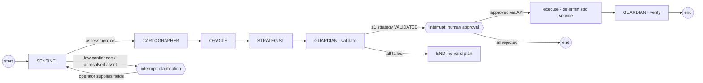

# Multi-Agent Design

**Package:** `app.agents` (LangGraph) + `app.llm` · Decisions: [ADR-0005](decisions/ADR-0005-llm-boundary-and-providers.md), [ADR-0006](decisions/ADR-0006-langgraph-orchestration.md)

## 1. Principles

1. **Agents never compute what an algorithm can compute.** Each agent is a LangGraph node that (a) calls **read-only deterministic tools**, (b) optionally asks an LLM to *interpret* input (SENTINEL) or *explain* tool results (all agents), and (c) returns a **Pydantic-validated** output.
2. **LLM output never becomes an action.** No LLM output schema contains fields that can change state: no asset statuses, no schedules, no approvals. STRATEGIST's LLM output is limited to rationale text keyed by strategy ID.
3. **Grounding check.** Every asset code, number and strategy ID mentioned in LLM text is extracted and checked against the tool outputs. If it fails, the system retries once with a correction prompt, then falls back to the deterministic template. The result of the check is recorded.
4. **Deterministic mode.** Every agent has a template- and rule-based implementation of its LLM step. With `LLM_PROVIDER=deterministic` (the default when no key is configured), the whole workflow runs offline and reproducibly.
5. **No chain-of-thought.** We store and show: inputs summary, tool calls (name, args, result hash, latency), structured output, short user-facing explanation, evidence, errors and retries.
6. **Untrusted input.** Free-text reports are data. They are wrapped in delimited blocks, the system prompt says they may contain instructions to ignore, and the output schema is narrow.

## 2. Workflow graph



- **State**: `IncidentWorkflowState` (Pydantic) with `incident_id`, `assessment`, `dependency_analysis`, `simulation_summary`, `strategy_ids`, `validation_reports`, `approval`, `execution_id`, `verification`, `errors[]`, `llm_mode`. Large objects stay in Postgres and the state carries IDs.
- **Checkpointing**: `AsyncPostgresSaver` (`thread_id = workflow_run.id`). The approval interrupt can wait indefinitely and survives restarts.
- **Approval resume**: the approve/execute API endpoints perform the governance transaction **first** (in the governance service). They then resume the graph with `Command(resume={...})`. The graph never authorises anything itself; the EXE node calls the same service and re-checks status.
- **Retries/timeouts**: each node has a `RetryPolicy(max_attempts=2, backoff)` for transient errors (LLM timeout, provider 5xx). LLM calls have a per-call timeout (default 30 s) and the node a 90 s budget. After retries are exhausted, the LLM step **falls back** to deterministic mode (`status=FELL_BACK`, visible in the UI). Tool or engine errors are not retried blindly: they fail the node, the run is marked `FAILED` with the error recorded, and the incident goes to `ANALYSIS_FAILED` (retryable).
- **Logging**: every node writes an `agent_execution` row (start, end, attempt) plus SSE events. Errors are never swallowed.

## 3. Agents

### SENTINEL — Incident Detection
| | |
|---|---|
| **Input** | Incident record (structured payload or raw report, plus optional sensor readings) |
| **Deterministic tools** | `resolve_asset_reference(text)` (exact code, alias, then fuzzy name match with a score, no LLM); `assets_near(point, radius)`; `assets_in_polygon(geojson, water_level)`; `validate_initiating_events(events)` |
| **LLM role** | Free text only: extract `incident_type`, mentioned places/assets (as text spans), time, severity cues, consequences mentioned. The LLM proposes spans; **tools resolve them to asset codes**. |
| **Output** `IncidentAssessment` | `incident_type, severity, occurred_at, affected_assets[{code, match_method, score}], initiating_events[], confidence, evidence[{span, text, kind}], missing_information[], potential_consequences[] (free text, flagged non-authoritative)` |
| **Confidence** | Deterministic formula: min(type-classification confidence, the lowest asset-match score), penalised by missing required fields. Below 0.6 → interrupt for clarification. |
| **Deterministic mode** | Keyword/regex classifier plus the same resolver tools |
| **Measurable contribution** | Extraction accuracy (type, asset, severity) on the labelled synthetic report corpus `data/synthetic/meridian-valley/reports/*.json`; time saved versus manual structuring |

### CARTOGRAPHER — Infrastructure Dependency
| | |
|---|---|
| **Tools** | `upstream`, `downstream`, `single_points_of_failure`, `isolated_components`, `explain_edge(provider, dependent)` |
| **LLM role** | Turn traversal results into a concise operator briefing ("SUB-02 feeds PDN-03 and PDN-04; HOS-02 has no alternate feeder…") |
| **Output** `DependencyAnalysis` | `focus_assets, downstream[{code, path, redundancy_remaining}], upstream_risks, single_points_of_failure, briefing, grounding_check` |
| **Contribution** | Every relationship in the briefing is traceable to an edge (grounding rate 100%); surfaces lost redundancy that isn't yet a failure |

### ORACLE — Simulation
| | |
|---|---|
| **Tools** | `run_simulation(initiating_events, horizon)` (persists a run); `failure_chains(run_id, top_n)`; `timeline(run_id)` |
| **LLM role** | Summarise the cascade: the highest-impact chains, the backup exhaustion timeline, consequences for critical services |
| **Output** `SimulationSummary` | `simulation_run_id, result_hash, impact_score, affected_counts, population_affected, critical_service_availability, key_chains[], deadlines[{asset, exhausts_at}], narrative` (all numbers are copied from the engine and checked for equality) |
| **Contribution** | Converts a 100+ event timeline into ranked deadlines and chains the operator can act on |

### STRATEGIST — Recovery Planning
| | |
|---|---|
| **Tools** | `generate_strategies(incident_id, run_id, inventory_version)` → 3 persisted DRAFT strategies; `compare_strategies(ids)`; `bottlenecks(strategy_id)` |
| **LLM role** | Explain trade-offs, why the top actions come first, and the bottlenecks, in rationale text per strategy ID |
| **Output** `StrategyProposal` | `strategy_ids[3], comparison_table (from tool), rationale{strategy_id: text}, recommended_strategy_id (from a deterministic rule: lowest weighted_unserved_service_hours among valid strategies, ties → lower risk), grounding_check` |
| **Contribution** | Explainable comparison; it cannot alter actions or numbers |

### GUARDIAN — Governance & Verification
| | |
|---|---|
| **Tools** | `validate_strategy(id)` (rules V-001…V-012, re-simulation); `verify_execution(execution_id)` |
| **LLM role** | **None for decisions.** Optional one-paragraph plain-language summary of a validation or verification report. |
| **Output** `GovernanceReport` / `VerificationReport` | per-strategy `{status, rule_results[]}`; verification `{repaired, functional, repaired_not_functional, unresolved, restoration_pct, matches_expectation}` |
| **Contribution** | Hard gate: an invalid plan never reaches the approval UI as approvable; repaired-vs-restored is made explicit |

## 4. LLM provider abstraction (`app.llm`)

```python
class LLMProvider(Protocol):
    name: str
    async def generate_structured(
        self, *, system: str, messages: list[Message], schema: type[T],
        timeout_s: float, max_tokens: int,
    ) -> LLMResult[T]: ...          # parsed: T, usage: TokenUsage | None, model, latency_ms
```

Implementations:
- `AnthropicProvider` (tool/JSON-schema structured output)
- `OpenAICompatibleProvider` (OpenAI, Azure, Ollama, vLLM, LM Studio through `base_url`)
- `DeterministicProvider`: dispatches to each agent's template/rule implementation

`FallbackChain([primary, secondary?, deterministic])` handles timeouts, rate limits, schema-validation failures (one repair attempt) and provider outages. Configuration comes from the environment: `LLM_PROVIDER`, `LLM_MODEL`, `LLM_BASE_URL`, `LLM_API_KEY`, `LLM_TIMEOUT_S`, `LLM_FALLBACK_PROVIDER`. Token usage is recorded per execution where the provider reports it.

## 5. Agent evaluation (Phase 3 acceptance)

- Golden workflow tests in deterministic mode: the full workflow for each predefined scenario gives exactly the expected strategy IDs, validation outcomes and hashes.
- Fault-injection tests: provider timeout, malformed JSON, schema violation, hallucinated asset code (grounding failure), tool exception. Each must produce the documented retry, fallback or failure record and never a silent success.
- Optional live-LLM eval (not in CI by default): SENTINEL corpus accuracy and grounding rate, recorded in `docs/reports/`.
