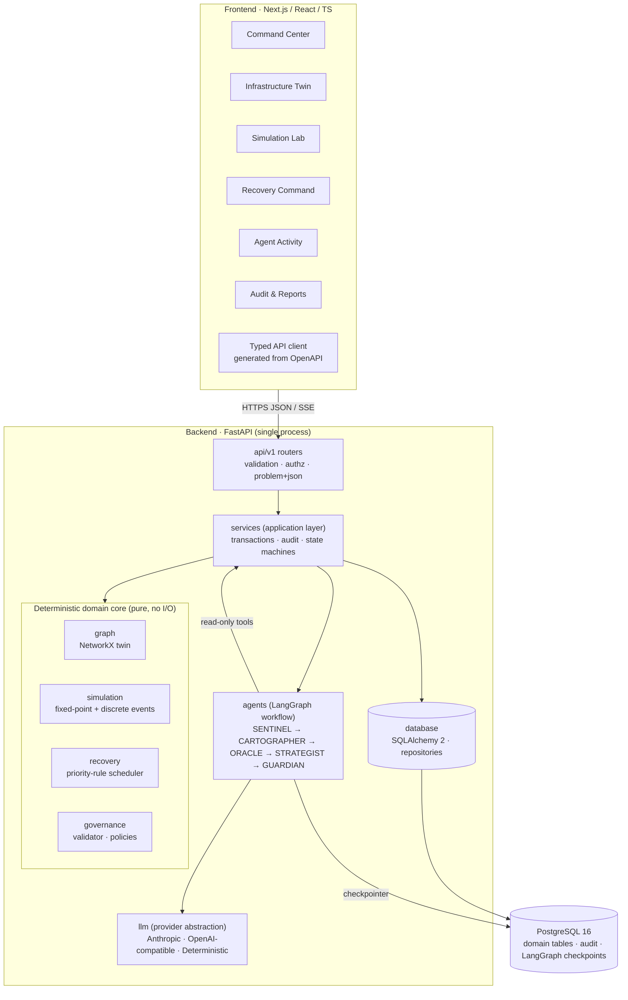
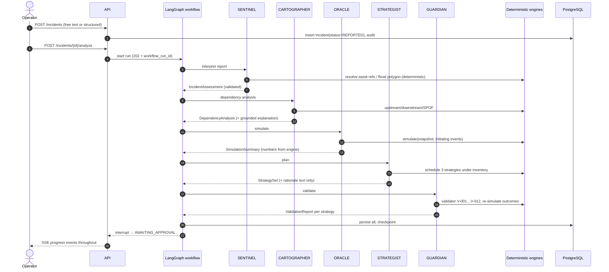
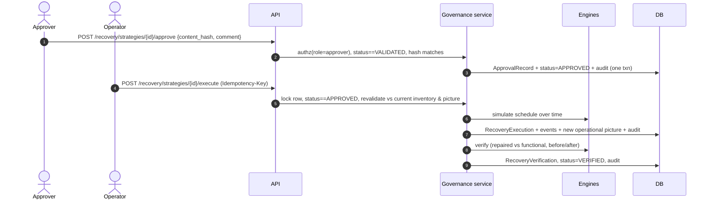

# AFTERMATH — System Architecture

**Status:** Proposed (Phase 0) · Related: [DATA_MODEL](DATA_MODEL.md) · [API_DESIGN](API_DESIGN.md) · [AGENT_DESIGN](AGENT_DESIGN.md) · [SIMULATION_ENGINE](SIMULATION_ENGINE.md) · [RECOVERY_OPTIMIZATION](RECOVERY_OPTIMIZATION.md) · [SECURITY](SECURITY.md) · [ADRs](decisions/)

## 1. Architectural style

AFTERMATH is a **modular monolith** ([ADR-0001](decisions/ADR-0001-modular-monolith.md)): one FastAPI process, one PostgreSQL database and one Next.js frontend. The backend is split into layers with enforced import rules. The deterministic domain core (graph, simulation, recovery, validation) is **pure Python with no I/O**. It does not know about HTTP, the database or LLMs.



### Layer rules (enforced with `import-linter` in CI)

| Layer | May import | Must not import |
|---|---|---|
| `app.graph`, `app.simulation`, `app.recovery`, `app.governance.rules` | each other (downward), stdlib, networkx, shapely, pydantic | `app.api`, `app.services`, `app.database`, `app.agents`, `app.llm`, `fastapi`, `sqlalchemy` |
| `app.llm` | pydantic, httpx/SDKs, `app.core` | domain, database, api, agents, services (import-linter contract) |
| `app.agents` | `app.services`, `app.llm`, schemas, the DB session factory and checkpointer (as implemented: agents sit between `app.api` and `app.services` in the layers contract) | `app.api` |
| `app.services` | domain core, database, agents | `app.api` |
| `app.api` | services, schemas, core | domain internals directly, database directly |

This keeps the engines reusable (CLI, notebooks, tests) and guarantees that agents can only reach the system through a narrow, audited facade.

## 2. Component responsibilities

| Component | Responsibility | Not responsible for |
|---|---|---|
| **graph** | Build an immutable `TwinSnapshot` → `nx.MultiDiGraph`; upstream/downstream traversal; components; static and structural criticality; dataset validation | Persistence, time |
| **simulation** | Functional-status evaluation (greatest fixed point over a status lattice), discrete-event timeline (backup expiry, restoration), impact scoring, result hashing | Choosing recovery actions |
| **recovery** | Action catalogue, resource model, three priority policies, serial schedule generation, expected-outcome curves, risk scoring | Approving or executing |
| **governance** | Deterministic plan validator (rules V-001…V-012), strategy/incident state machines, content hashing, verification comparison | Authentication |
| **services** | Load snapshots, call engines, persist results, enforce state transitions in transactions, write audit records, emit SSE events | Algorithms |
| **agents** | LangGraph workflow, the 5 agents, structured outputs, grounding checks, execution logging, human-approval interrupt | Calculations, authorisation |
| **llm** | Provider-neutral `generate_structured()`, timeouts, retries, fallback chain, token accounting, deterministic provider | Business rules |
| **api** | HTTP contract, request validation, authN/authZ, idempotency, problem+json errors, request IDs | Business logic |
| **database** | SQLAlchemy models, repositories, Alembic migrations, append-only audit triggers | Domain decisions |
| **frontend** | Six screens, map and graph visualisation, typed client, SSE subscription | Any calculation shown as authoritative |

## 3. Core runtime flows

### 3.1 Incident → strategies (agent workflow)



### 3.2 Approval → execution → verification



## 4. The operational picture (state model)

The **baseline twin** (assets and dependencies as seeded) is never mutated by simulations. Instead:

- A **SimulationRun** is an immutable record: `(snapshot_version, initiating events, config) → result`. "What-if" runs in the Simulation Lab are just runs.
- An **Incident** owns a chain of states: `baseline → post-incident (from its simulation) → post-recovery (from execution)`. The **current operational picture** is the latest state of the active incident. It is shown in the Command Center and stored as an `asset_state` snapshot on the run or execution.
- "Reset" restores the picture to baseline by closing the incident's picture chain. It never deletes history.

This gives reproducibility (every state can be recomputed from inputs) and keeps "what-if" exploration from corrupting the operational view.

## 5. Real-time updates

Workflow progress, simulation playback and execution progress are pushed over **Server-Sent Events** (`GET /api/v1/workflows/{id}/events`). The frontend falls back to polling. No Redis or WebSocket infrastructure is needed for a single process ([ADR-0010](decisions/ADR-0010-sse-for-realtime.md)). Long-running work (agent workflows) runs as in-process asyncio tasks. Its state is checkpointed in Postgres, so a restart resumes from the last checkpoint ([ADR-0006](decisions/ADR-0006-langgraph-orchestration.md)).

## 6. Technology stack (validated)

| Concern | Choice | Verdict / note |
|---|---|---|
| Frontend framework | Next.js (App Router) + React + TypeScript | ✅ Keep. The screens are client-heavy, so feature screens are client components; SSR isn't needed but is harmless. |
| Styling/UI | Tailwind CSS 4 + shadcn/ui-style primitives | ✅ Phase 1 uses a small set of hand-written primitives (`components/ui`) in the shadcn style. CLI-generated shadcn components are added when a screen needs them. |
| Server state | **TanStack Query** (added) | Caching, retries, polling and loading/error states with no hand-rolled code. |
| Map | MapLibre GL JS | ✅ Uses a **self-generated synthetic basemap** (GeoJSON layers) with no third-party tiles or glyph server; labels are DOM markers ([ADR-0009](decisions/ADR-0009-fictional-district-basemap.md)). |
| Graph viz | React Flow (`@xyflow/react`) + `elkjs` layered layout | ✅ ELK gives readable layouts for dependency DAG-like graphs. |
| Charts | Recharts | ✅ |
| Motion | Motion (formerly Framer Motion) | ✅ Used sparingly. |
| API types | `openapi-typescript` generated from FastAPI's OpenAPI | Single source of truth, no duplicated DTOs ([ADR-0011](decisions/ADR-0011-openapi-generated-types.md)). |
| Backend | Python 3.13, FastAPI, Pydantic v2, pydantic-settings | ✅ |
| ORM / migrations | SQLAlchemy 2.1 (async) + **asyncpg** + Alembic | psycopg 3 was planned, but its bundled libpq is blocked by Windows Application Control on the dev host ([ENVIRONMENT](ENVIRONMENT.md)). The checkpointer driver question moves to Phase 3. |
| Graph | NetworkX | ✅ Ample for 50–5 000 nodes ([ADR-0002](decisions/ADR-0002-networkx-graph-engine.md)). |
| Geometry | **Shapely** (added) | Flood-polygon intersection and distances; avoids PostGIS ([ADR-0007](decisions/ADR-0007-postgres-jsonb-geometry.md)). |
| Orchestration | LangGraph + `langgraph-checkpoint-postgres` | ✅ Typed state, interrupts and checkpoints are exactly the HITL needs. |
| LLM | Own thin provider abstraction (no LangChain chat models) | ([ADR-0005](decisions/ADR-0005-llm-boundary-and-providers.md)) |
| Logging | structlog (JSON), request/simulation/agent IDs via contextvars | |
| Testing | pytest, pytest-asyncio, HTTPX, Hypothesis, Playwright, Vitest | |
| Quality | ruff, mypy (strict on the domain core), import-linter, ESLint, tsc, pre-commit | |
| Packaging | **uv** (backend), **pnpm** (frontend) | |
| Runtime | Docker Compose: `db`, `backend`, `frontend` | Redis deliberately omitted ([ADR-0006](decisions/ADR-0006-langgraph-orchestration.md)). |

Rejected or deferred: Neo4j (no requirement justifies it), PostGIS (no spatial queries at this scale), Redis/Celery (no multi-process work queue needed), OR-Tools CP-SAT (deferred until the heuristic's optimality gap is measured; see [ADR-0004](decisions/ADR-0004-recovery-scheduling-heuristic.md)), microservices.

## 7. Repository structure

```
aftermath/
├── backend/
│   ├── app/
│   │   ├── main.py                 # app factory, middleware, routers
│   │   ├── core/                   # config, logging, errors, security, ids, clock
│   │   ├── api/v1/                 # routers: infrastructure, incidents, simulations,
│   │   │                           #   scenarios, recovery, workflows, agents, audit, system, auth
│   │   ├── schemas/                # Pydantic API DTOs
│   │   ├── graph/                  # PURE: snapshot, builder, traversal, criticality, dataset validation
│   │   ├── simulation/             # PURE: lattice evaluator, event engine, impact, hashing
│   │   ├── recovery/               # PURE: actions, resources, policies, scheduler, risk
│   │   ├── governance/
│   │   │   └── rules/              # PURE: validator, state machine, policies, verification
│   │   │                           #   (the DB-backed approval/execution service is
│   │   │                           #    services/governance.py: the layer contract puts
│   │   │                           #    governance below database, so it cannot hold I/O)
│   │   ├── agents/                 # LangGraph workflow, agents, prompts, output schemas, tools facade
│   │   ├── llm/                    # provider protocol, anthropic, openai_compat, deterministic, fallback
│   │   ├── services/               # application services (infrastructure, incident, simulation, recovery, audit)
│   │   └── database/               # engine/session, models/, repositories/
│   ├── migrations/                 # Alembic
│   ├── tests/  {unit, property, integration, agents, fixtures}
│   └── pyproject.toml
├── frontend/
│   ├── app/                        # routes: /, /twin, /lab, /recovery, /agents, /audit
│   ├── components/                 # ui primitives (shadcn) + shared (StatusBadge, SimulationBanner…)
│   ├── features/                   # twin/, simulation/, recovery/, agents/, audit/, command-center/
│   ├── lib/                        # api client, query keys, sse, formatting, map style
│   ├── types/                      # generated api.d.ts
│   ├── e2e/                        # Playwright
│   └── public/
├── data/
│   ├── synthetic/meridian-valley/  # assets.json, dependencies.json, basemap.geojson, inventory.json, reports/
│   ├── scenarios/                  # scenario definitions (JSON)
│   └── schemas/                    # JSON Schemas for the above
├── docs/                           # this documentation; decisions/ = ADRs
├── scripts/                        # seed, validate-dataset, gen-api-types, replay-check (Python)
├── docker-compose.yml
├── .env.example
└── README.md
```

Differences from the brief's reference structure: `models/` becomes `database/models/` (keeping ORM models away from domain models); `llm/` is added as a separate package; `governance/rules` is split from the governance service so the validator stays pure; `docs/architecture` and `docs/testing` are flattened into top-level docs until they grow.
