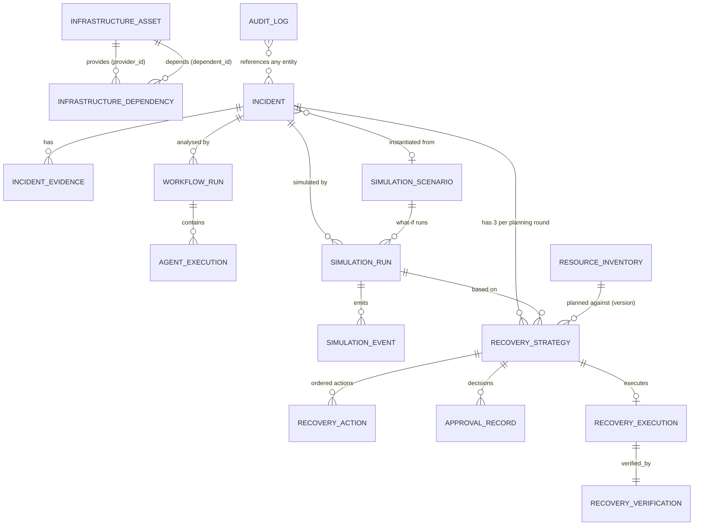
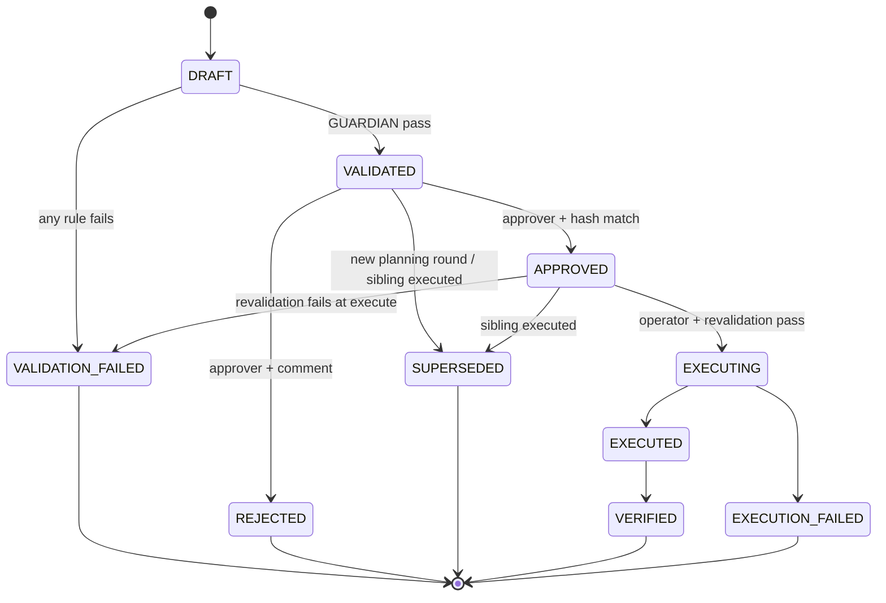

# Data Model

**Database:** PostgreSQL 16 · **ORM:** SQLAlchemy 2.0 · **Migrations:** Alembic · Decision: [ADR-0007](decisions/ADR-0007-postgres-jsonb-geometry.md)

## Conventions

- Primary keys are `UUID` (generated server-side, v7 for index locality where available; v4 otherwise). Assets also have a human-readable unique `code` (`SUB-02`), which the engines and the UI use.
- Every table has `created_at timestamptz NOT NULL DEFAULT now()`. Mutable tables also have `updated_at` and an integer `version` for optimistic concurrency.
- Enums are PostgreSQL `text` columns with `CHECK` constraints. This is easier to migrate than native enums.
- Geometry is GeoJSON in `jsonb` (Point for facilities, LineString for roads, Polygon for zones and flood areas) and is validated by Pydantic plus Shapely on write.
- **Synthetic marking:** `is_synthetic boolean NOT NULL DEFAULT true CHECK (is_synthetic)` on assets, incidents and scenarios. The check constraint makes it impossible to store non-synthetic data until a future, explicitly approved migration removes it.
- Engine outputs that are read as a whole (state snapshots, metrics, curves) are `jsonb`. Things that are queried or filtered (events, actions, approvals) are rows.

## Entity-relationship overview

## Entities

### 0. `dataset_release` (added in Phase 1)
`id, name, version, content_hash (SHA-256 of the canonical TwinSnapshot), asset_count, dependency_count, basemap jsonb, bounds jsonb, is_current (partial unique index), is_synthetic CHECK, created_at`. Unique `(name, version)`. Seeding is idempotent per version. Reusing a version with different assets **or** a different basemap is rejected. On load, the API recomputes the snapshot hash from the stored rows and refuses to serve them if it doesn't match the release (an integrity check against out-of-band edits).

### 1. `infrastructure_asset`
| Column | Type | Notes |
|---|---|---|
| id | uuid PK | |
| code | text UNIQUE NOT NULL | e.g. `SUB-02`, matches `^[A-Z]{2,5}-\d{2,3}$` |
| name | text NOT NULL | |
| category | text NOT NULL | `GRID_SUPPLY, POWER_GENERATION, SUBSTATION, POWER_DISTRIBUTION, HOSPITAL, TELECOM_TOWER, TELECOM_HUB, WATER_INTAKE, WATER_TREATMENT, WATER_PUMPING, EMERGENCY_OPS_CENTER, FIRE_STATION, ROAD_SEGMENT, BRIDGE, FUEL_DEPOT, DATA_CENTER, DEMAND_ZONE` |
| geometry | jsonb NOT NULL | GeoJSON |
| elevation_m | numeric(6,2) | used by flood resolution |
| physical_condition | text NOT NULL | baseline condition (`INTACT` for seed data) |
| criticality | smallint NOT NULL CHECK 0–100 | static criticality |
| capacity, capacity_unit | numeric, text | e.g. 40 MVA, 300 beds |
| utilization | numeric CHECK 0–1 | |
| population_served | integer | DEMAND_ZONE: residents; others: optional |
| is_source | boolean | needs no upstream supply |
| backup_power_hours | numeric(5,2) NULL | generator/battery endurance |
| recovery_profile | jsonb | `{trade, crew_size, repair_minutes, replace_minutes, parts:{kind:qty}, replace_parts:{kind:qty}, cost}` |
| metadata | jsonb | operator, year built, notes |
| dataset_version | text NOT NULL | ties the row to a seeded dataset release |
| is_synthetic | boolean CHECK (is_synthetic) | |
| created_at, updated_at, version | | |

Indexes: `category`, `code` (unique), GIN on `metadata` (only if needed later).

The baseline table is never mutated by simulation. Current runtime status lives in simulation and execution snapshots (see [ARCHITECTURE §4](ARCHITECTURE.md#4-the-operational-picture-state-model)).

### 2. `infrastructure_dependency`
| Column | Type | Notes |
|---|---|---|
| id | uuid PK | |
| provider_id, dependent_id | uuid FK → asset, ON DELETE RESTRICT | CHECK provider ≠ dependent |
| service_type | text | `POWER, TELECOM, WATER, FUEL, DATA, HEALTHCARE, ACCESS` (HEALTHCARE: demand zone → hospital) |
| mode | text | `HARD, SOFT` |
| redundancy_group | text NOT NULL | e.g. `power-main` |
| min_required | smallint CHECK ≥ 1 | k for the group (consistency across the group is checked by the dataset validator) |
| description | text | why this dependency exists (shown in the UI) |

Unique `(provider_id, dependent_id, service_type)`. Indexes: `dependent_id`, `provider_id`.

### 3. `incident`
| Column | Notes |
|---|---|
| id uuid PK; reference text UNIQUE (`INC-2026-0001`) | |
| source | `MANUAL, STRUCTURED, FREE_TEXT, SENSOR, SCENARIO` |
| raw_report text NULL | untrusted user text, stored verbatim |
| incident_type | `POWER_FAILURE, FLOODING, TELECOM_OUTAGE, WATER_DISRUPTION, EQUIPMENT_FAILURE, COMBINED` (nullable until assessed) |
| severity | `LOW, MODERATE, HIGH, CRITICAL` |
| occurred_at timestamptz; location jsonb (GeoJSON) | |
| initiating_events jsonb | normalised engine input (validated) |
| confidence numeric(3,2) | from SENTINEL, or 1.0 for structured input |
| missing_information jsonb | list of fields SENTINEL could not establish |
| scenario_id FK NULL | |
| status | see lifecycle |
| is_synthetic, created_at, updated_at, version | |

**Lifecycle:** `REPORTED → ANALYZING → AWAITING_APPROVAL → RECOVERING → RECOVERED → CLOSED`, with side exits `ANALYSIS_FAILED` (retryable → ANALYZING) and `CLOSED` from any non-RECOVERING state (with reason).

### 4. `incident_evidence`
`id, incident_id FK, kind (REPORT_SPAN, SENSOR_READING, ASSET_MATCH, GEOSPATIAL_MATCH, OPERATOR_NOTE), content jsonb (e.g. {span:[start,end], text} or {asset_code, match_score}), source_agent_execution_id FK NULL, confidence, created_at`.

### 5. `simulation_scenario`
`id, key text UNIQUE ('substation-riverside'), name, description, initiating_events jsonb, horizon_minutes int, expected_outcomes jsonb NULL (for golden tests), is_predefined bool, is_synthetic, created_at, version`.

### 6. `simulation_run`
| Column | Notes |
|---|---|
| id uuid PK | |
| incident_id FK NULL, scenario_id FK NULL | a what-if run may have neither (custom inputs) |
| kind | `IMPACT` (failure cascade), `RECOVERY` (schedule playback) |
| inputs jsonb, config jsonb | initiating events, horizon, scoring weights |
| snapshot_version, engine_version, scoring_version | text |
| status | `PENDING → RUNNING → COMPLETED | FAILED` |
| final_state jsonb | per-asset `{condition, status, level, backup_remaining, caused_by}` |
| metrics jsonb | impact score, affected counts, population, service availability, isolated components |
| result_hash char(64) | reproducibility |
| error jsonb NULL; started_at, completed_at, duration_ms | |

Index `(incident_id, created_at desc)`.

### 7. `simulation_event`
`id bigserial PK, run_id FK, seq int, t_minutes int, wave int, event_type, asset_id FK NULL, from_status, to_status, details jsonb`. Unique `(run_id, seq)`; index `(run_id, t_minutes, wave)`. Append-only.

### 8. `resource_inventory`
Versioned snapshot rows (not one row per resource) so that strategies reference an exact inventory:
`id, version int UNIQUE, renewables jsonb ({ELECTRICAL_CREW: 3, …}), consumables jsonb ({fuel_l: 20000, transformer: 1, budget: 500000, …}), reason text, created_by, created_at, is_current bool` (partial unique index on `is_current`).

### 9. `recovery_strategy`
| Column | Notes |
|---|---|
| id; incident_id FK; simulation_run_id FK; inventory_version int | |
| planning_round int | regenerating strategies starts a new round; older rounds become `SUPERSEDED` |
| policy | `CRITICAL_FIRST, MAX_RESTORATION, BALANCED` |
| objective, rationale text | rationale = STRATEGIST text, may be the deterministic template |
| metrics jsonb | times, curves, consumption, unserved service-hours |
| risk_score numeric(4,1); benefits jsonb; limitations jsonb; unschedulable jsonb | |
| content_hash char(64) | canonical hash of policy + actions + metrics + inputs |
| validation_report jsonb NULL; validated_at | |
| status | see lifecycle |
| created_at, updated_at, version | |

**Lifecycle (enforced by `governance.rules.state_machine` and DB CHECK on allowed values):**

`REJECTED`, `VALIDATION_FAILED` and `SUPERSEDED` are terminal. Nothing transitions out of them.

### 10. `recovery_action`
`id, strategy_id FK, seq int, action_type, target_asset_id FK, start_minute, end_minute, trade, crew_count, consumables jsonb, prerequisite_seqs int[], expected_effect jsonb, rationale text`. Unique `(strategy_id, seq)`. CHECK `end_minute > start_minute >= 0`.

### 11. `recovery_execution` (the `recovery_id` in the API)
`id, strategy_id FK UNIQUE, simulation_run_id FK (kind=RECOVERY), requested_by, idempotency_key UNIQUE, status (RUNNING, COMPLETED, FAILED), error jsonb, started_at, completed_at`.

### 12. `recovery_verification`
`id, execution_id FK UNIQUE, before_state_ref, after_state_ref, repaired_assets jsonb, functionally_restored jsonb, repaired_not_functional jsonb, unresolved jsonb, restoration jsonb ({by_count, by_criticality, by_population}), matches_expectation bool, verified_by_agent_execution_id FK NULL, created_at`.

### 13. `workflow_run` (added; groups agent executions)
`id, incident_id FK, thread_id text UNIQUE (LangGraph), status (RUNNING, AWAITING_APPROVAL, COMPLETED, FAILED, CANCELLED), current_node, llm_mode (DETERMINISTIC|LLM), started_at, completed_at, error jsonb`.

### 14. `agent_execution`
`id, workflow_run_id FK, agent (SENTINEL|CARTOGRAPHER|ORACLE|STRATEGIST|GUARDIAN), attempt int, status (RUNNING, SUCCEEDED, FAILED, RETRIED, FELL_BACK), input_summary jsonb, output jsonb (validated schema), tool_calls jsonb (name, args, result hash, ms), provider, model, tokens_in, tokens_out, latency_ms, error jsonb, grounding_check jsonb, started_at, completed_at`. Index `(workflow_run_id, started_at)`. **No chain-of-thought is stored**, only structured outputs and short user-facing summaries.

### 15. `approval_record`
`id, strategy_id FK, decision (APPROVED|REJECTED), content_hash char(64) (must equal strategy.content_hash at decision time), actor_id, actor_role, comment text (required for REJECTED), created_at`. Append-only.

### 16. `audit_log`
| Column | Notes |
|---|---|
| id bigserial PK; occurred_at | |
| actor_type (`USER, AGENT, SYSTEM`), actor_id | |
| action | dotted verb, e.g. `strategy.approved`, `simulation.completed` |
| entity_type, entity_id | |
| request_id, workflow_run_id NULL | correlation |
| before jsonb NULL, after jsonb NULL, details jsonb | minimal diffs |
| prev_hash, hash char(64) | `hash = sha256(prev_hash ‖ canonical(row))`: a tamper-evident chain |

Append-only: a trigger rejects `UPDATE`/`DELETE`, and the application DB role has only `INSERT, SELECT` on this table. Indexes: `(entity_type, entity_id)`, `occurred_at`, `request_id`.

### 17. `app_user` (Phase 5)
`id, username UNIQUE, password_hash (argon2), roles text[], is_active, created_at`.

## Phase mapping

| Phase | Tables introduced |
|---|---|
| 1 | dataset_release, infrastructure_asset, infrastructure_dependency, audit_log (with append-only trigger) |
| 2 | incident, incident_evidence, simulation_scenario, simulation_run, simulation_event |
| 3 | workflow_run, agent_execution (+ LangGraph checkpoint tables via its own setup) |
| 4 | resource_inventory, recovery_strategy, recovery_action |
| 5 | approval_record, recovery_execution, recovery_verification, app_user |

## As implemented (Phase 2, migration `0002`)

- `simulation_scenario`, `incident`, `incident_evidence`, `simulation_run`, `simulation_event` as specified, with these differences:
  - `incident.title` was added.
  - `simulation_run.status` is `COMPLETED | FAILED` only, because runs are synchronous (milliseconds).
  - `simulation_event.asset_code` is a text code rather than an FK, since codes are stable and events must stay readable even if a later dataset removes an asset.
- **New: `operational_picture_change`** `(id, kind APPLY|RESET, simulation_run_id, actor_id, reason, created_at)`. This is the append-only history of what the operational picture shows. The current picture is the latest row (APPLY shows that run's final state; RESET or no rows shows the baseline).
- **Immutability:** a `reject_mutation()` trigger blocks UPDATE/DELETE on `simulation_run`, `simulation_event` and `operational_picture_change`, alongside the audit log.
- Incident references come from the `incident_reference_seq` sequence: `INC-<year>-<nnnn>`.
